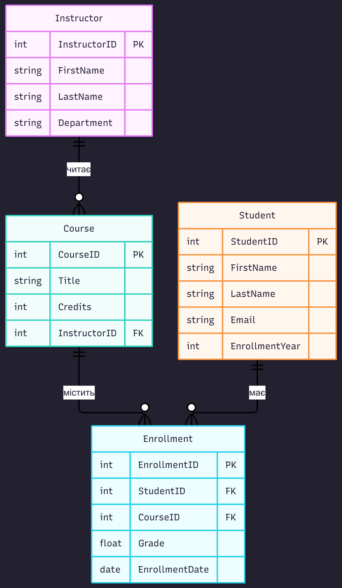

# Лабораторна робота №1: Збір вимог та розробка схеми ER

## 1. Короткий виклад вимог
* **Призначення системи:** Автоматизація обліку студентів, викладачів, навчальних курсів та процесів їх зарахування в університеті.
* **Основні зацікавлені сторони:** Студенти, викладачі, адміністратори бази даних.
* **Бізнес-правила:**
  - Студент може бути зарахований максимум на 5 курсів за один семестр.
  - Кожен курс закріплений рівно за одним викладачем.
  - Усі оцінки зберігаються в діапазоні від 0 до 100 балів.

## 2. Список сутностей та атрибутів
1. **Student (Студент):**
   - `StudentID` (PK) — унікальний ідентифікатор студента.
   - `FirstName` — ім'я.
   - `LastName` — прізвище.
   - `Email` — електронна пошта.
   - `EnrollmentYear` — рік вступу.

2. **Instructor (Викладач):**
   - `InstructorID` (PK) — унікальний ідентифікатор викладача.
   - `FirstName` — ім'я.
   - `LastName` — прізвище.
   - `Department` — кафедра.

3. **Course (Курс):**
   - `CourseID` (PK) — код/ідентифікатор курсу.
   - `Title` — назва курсу.
   - `Credits` — кількість кредитів ECTS.
   - `InstructorID` (FK) — посилання на викладача.

4. **Enrollment (Зарахування — асоціативна сутність):**
   - `EnrollmentID` (PK) — ідентифікатор запису.
   - `StudentID` (FK) — посилання на студента.
   - `CourseID` (FK) — посилання на курс.
   - `Grade` — підсумкова оцінка.
   - `EnrollmentDate` — дата реєстрації.

## 3. Опис зв'язків
* **Instructor до Course (1:N):** Один викладач може читати кілька курсів, але кожен курс ведеться тільки одним викладачем.
* **Student та Course через Enrollment (M:N):** Оскільки студент може відвідувати багато курсів, а на курсі навчається багато студентів, зв'язок «багато-до-багатьох» реалізовано через проміжну (асоціативну) сутність `Enrollment`.

## 4. ER-діаграма

## 5. Припущення та обмеження
* Кількість кредитів обмежена діапазоном від 1 до 10.
* Студент не може двічі зараховуватися на один і той самий курс у межах одного семестру.
